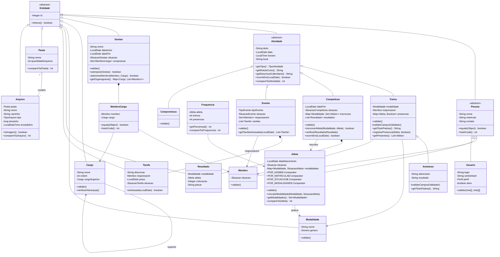
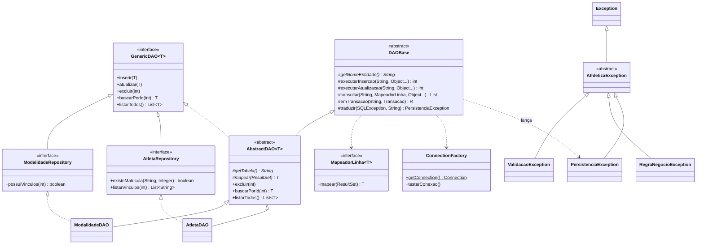
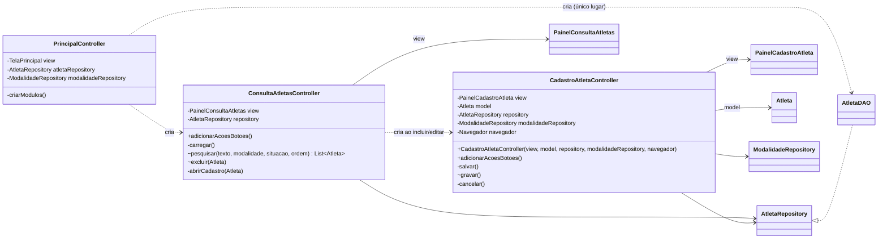

# Diagrama de classes (CH-09)

Dividido em quatro partes para ficar legível: modelo, persistência (DAO), controllers e telas.
O GitHub desenha os diagramas automaticamente; as mesmas imagens estão em [`imagens`](imagens).
Para exportar de novo, cole o código em <https://mermaid.live> e use **Actions > PNG**.

Como os pacotes se relacionam (regras do MVC vistas em aula):

- **model** não conhece nenhum outro pacote (só `exception`): entidades e regras de negócio (`validar()`).
- **view** conhece o **model** (e utilitários como `Cores`), nunca controller ou DAO: monta a tela, devolve o que foi digitado, mostra mensagens.
- **controller** conhece **view**, **model** e as **interfaces** do pacote `dao` (nunca as classes DAO).
- **dao** conhece o **model**: cada `XDAO` implementa a interface `XRepository`.
- Só o `PrincipalController` (e o `main`) cria os DAOs: é ali que se troca o banco, se precisar (DIP).

## 1. Modelo (`br.com.athletiza.model`)

Herança, classes abstratas e as coleções (List, Map, Set) usadas nas associações.

Enums do modelo: `Situacao`, `SituacaoAtleta`, `Genero`, `Perfil`, `TipoAtividade`, `TipoEvento`,
`SituacaoGestao`, `SituacaoCompeticao`, `SituacaoEvento`, `SituacaoTarefa`, `TipoArquivo`.

As regras de preenchimento ficam no próprio modelo (como o `isValido()` do exemplo de MVC da aula):
cada entidade tem `validar()`, que usa o `Validador` (também no pacote `model`) e lança
`ValidacaoException` com todos os erros. Em `Treino`/`Amistoso` a validação é polimórfica:
`Amistoso` sobrescreve `validarCampos` para conferir também o adversário.

## 2. Persistência (`br.com.athletiza.dao`) e exceções

Padrão DAO com **Inversão de Dependência (DIP)**: os controllers dependem das interfaces
`XRepository` (abstração); as classes `XDAO` (detalhe, com JDBC e MySQL) implementam essas interfaces.
É o mesmo esquema do exemplo `AlunoRepository` / `AlunoDAO` da aula.

Todas as entidades seguem o mesmo par interface / implementação:

| Interface (abstração) | Implementação (JDBC) | Métodos além do GenericDAO |
|---|---|---|
| `ModalidadeRepository` | `ModalidadeDAO` | `possuiVinculos` |
| `AtletaRepository` | `AtletaDAO` | `existeMatricula`, `listarVinculos` |
| `MembroRepository` | `MembroDAO` | `listarAtivos`, `existeMatricula`, `listarVinculos` |
| `CargoRepository` | `CargoDAO` | `contarOcupacoes` |
| `GestaoRepository` | `GestaoDAO` | `carregarComposicao`, `adicionarMembro`, `removerMembro`, `trocarMembro` |
| `CompeticaoRepository` | `CompeticaoDAO` | `carregarInscricoes`, `salvarInscricoes`, `listarResultados`, `salvarResultado`, `excluirResultado` |
| `TreinoRepository` | `TreinoDAO` | `listar`, `listarNoMesmoDiaELocal`, `resumirPresencas`, `carregarPresencas`, `salvarPresencas`, `frequencia`, `historicoDoAtleta` |
| `EventoRepository` | `EventoDAO` | `carregarDetalhes`, `adicionarResponsavel`, `removerResponsavel` |
| `CompromissoRepository` | `CompromissoDAO` | `listarPorPeriodo` |
| `UsuarioRepository` | `UsuarioDAO` | `buscarPorLogin`, `existeLogin`, `contarOutrosAdministradoresAtivos` |
| `PastaRepository` | `PastaDAO` | (só os do GenericDAO) |
| `ArquivoRepository` | `ArquivoDAO` | `listarPorPasta` |
| `TarefaRepository` | `TarefaDAO` | `listar`, `salvar`, `excluir` (de um evento ou competição) |
| `AtividadeRepository` | `AtividadeDAO` | `listarPorPeriodo` (todas as atividades do calendário) |
| `AlertaRepository` | `AlertaDAO` | `tarefasAtrasadas`, `treinosSemPresenca`, `competicoesProximas` |

## 3. Controllers (`br.com.athletiza.controller`)

Um controller por tela, como no exemplo `PacienteController` da aula: tem a View e o Model como
atributos, recebe tudo no construtor (inclusive os repositórios, pela interface) e registra as ações
dos botões com lambda em `adicionarAcoesBotoes()`. Cada ação chama um único fluxo de caso de uso.

| Módulo | Controllers |
|---|---|
| Login e janela principal | `LoginController`, `PrincipalController`, `AlterarSenhaController` |
| Início | `CalendarioController`, `CompromissoController` |
| Gestão | `ConsultaGestoesController`, `CadastroGestaoController`, `GerenciarGestaoController`, `OrganogramaController`, `ConsultaCargosController`, `CadastroCargoController`, `ConsultaMembrosController`, `CadastroMembroController` |
| Atletas | `ConsultaAtletasController`, `CadastroAtletaController`, `ConsultaModalidadesController`, `CadastroModalidadeController` |
| Competições | `ConsultaCompeticoesController`, `CadastroCompeticaoController`, `GerenciarCompeticaoController`, `ResultadosController`, `TarefasController` |
| Treinos | `TreinosController`, `CadastroTreinoController`, `PresencaController`, `FrequenciaController`, `HistoricoAtletaController` |
| Eventos | `ConsultaEventosController`, `CadastroEventoController`, `GerenciarEventoController`, `TarefasController` |
| Registros | `RegistrosController` |
| Usuários | `ConsultaUsuariosController`, `CadastroUsuarioController` |

## 4. Telas (`br.com.athletiza.view`)

As telas não conhecem controllers nem DAOs. As classes base já trazem o que a View faz no MVC:
`adicionarAcaoX(ActionListener)` para o Controller registrar os botões, `mostrarMensagem`,
`mostrarErro`, `confirmar` e, nas consultas, `exibir(lista)` e `getSelecionado()`.

```mermaid
classDiagram
    direction TB

    class Navegador {
        <<interface>>
        +abrir(JComponent)
        +voltar()
    }
    class Recarregavel {
        <<interface>>
        +carregar()
    }
    class PainelConsulta~T~ {
        <<abstract>>
        #ModeloTabela~T~ modelo
        #JTable tabela
        +exibir(List~T~)
        +getSelecionado() T
        +adicionarAcaoCarregar(ActionListener)
        +adicionarAcaoIncluir(ActionListener)
        +adicionarAcaoEditar(ActionListener)
        +adicionarAcaoExcluir(ActionListener)
        +adicionarAcaoGerenciar(ActionListener)
        +mostrarMensagem(String)
        +mostrarErro(Exception)
        +confirmar(String) boolean
        +carregar()
    }
    class PainelFormulario {
        <<abstract>>
        +adicionarAcaoSalvar(ActionListener)
        +adicionarAcaoCancelar(ActionListener)
        +getBtnSalvar() JButton
        +mostrarMensagem(String)
        +mostrarErro(Exception)
        +confirmar(String) boolean
        #adicionarCampo(String, JComponent, boolean)
    }
    class PainelCadastroAtleta {
        -JTextField nome
        -JTextField matricula
        -inicializarComponentes()
        +preencherCampos(Atleta, List~Modalidade~)
        +getNome() String
        +getMatricula() String
        +getModalidadesMarcadas() Map
    }
    class ModeloTabela~T~ {
        +coluna(String, Class, Function) ModeloTabela
        +setLinhas(List~T~)
    }
    class TelaPrincipal {
        -CardLayout cartoes
        -Deque~JComponent~ telasAbertas
        +adicionarModulo(String, JComponent)
    }

    JPanel <|-- PainelConsulta
    JPanel <|-- PainelFormulario
    Recarregavel <|.. PainelConsulta
    Navegador <|.. TelaPrincipal
    JFrame <|-- TelaPrincipal
    JFrame <|-- TelaLogin
    PainelConsulta --> ModeloTabela
    AbstractTableModel <|-- ModeloTabela
    PainelFormulario <|-- PainelCadastroAtleta

    PainelConsulta <|-- PainelConsultaAtletas
    PainelConsulta <|-- PainelConsultaGestoes
    PainelConsulta <|-- PainelConsultaCompeticoes
    PainelConsulta <|-- PainelTreinos
    PainelConsulta <|-- PainelConsultaEventos
    PainelConsulta <|-- PainelConsultaUsuarios
    PainelFormulario <|-- PainelCadastroGestao
    PainelFormulario <|-- PainelCadastroCompeticao
    PainelFormulario <|-- PainelCadastroTreino
    PainelFormulario <|-- PainelPresenca
    PainelFormulario <|-- PainelCadastroEvento
    Recarregavel <|.. PainelCalendario
    Recarregavel <|.. PainelGerenciarCompeticao
    Recarregavel <|.. PainelOrganograma
    Recarregavel <|.. PainelRegistros
    JComponent <|-- CartaoArquivo
    PainelRegistros --> CartaoArquivo
```

