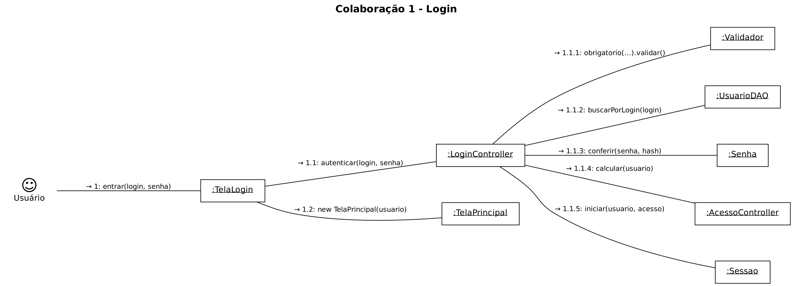
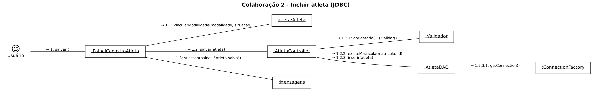
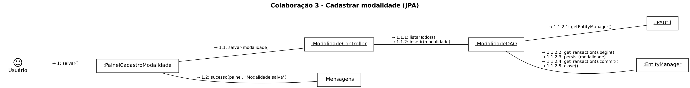
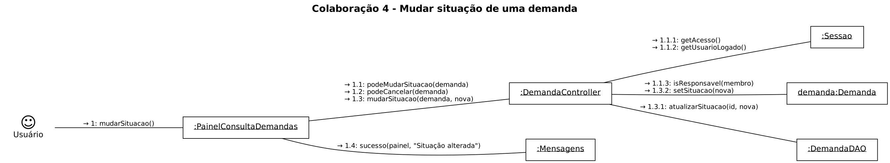

# Diagramas de colaboração

Cada diagrama mostra os objetos que participam de um fluxo e as mensagens trocadas entre eles, numeradas na
ordem em que acontecem (1, 1.1, 1.1.1...). Os mesmos fluxos aparecem nos diagramas de sequência, que mostram a
ordem no tempo; aqui o foco são as ligações entre os objetos.

| # | Fluxo | Persistência |
|---|---|---|
| 1 | Login | JDBC |
| 2 | Incluir atleta | JDBC |
| 3 | Cadastrar modalidade | JPA |
| 4 | Mudar situação de uma demanda | JDBC |

## 1. Login

## 2. Incluir atleta

## 3. Cadastrar modalidade (JPA)

## 4. Mudar situação de uma demanda

Os arquivos `.dot` usados para gerar as imagens estão em `imagens/fontes/` e podem ser abertos no Graphviz.
