# Diagramas de sequência (CH-48)

Cada diagrama segue o MVC como visto em aula:

1. O **Controller** registra as ações dos botões da **View** com lambda (`view.adicionarAcaoSalvar(e -> salvar())`).
2. O usuário clica; a View só avisa o Controller.
3. O Controller lê os campos da View (`view.getNome()`), passa para o **Model** e chama `model.validar()`
   (regra de negócio no Model).
4. O Controller grava pelo **Repository** (interface); quem executa é o **DAO** (JDBC), que fala com o banco.
5. Se algo der errado, a exceção (`ValidacaoException`, `RegraNegocioException` ou `PersistenciaException`)
   **sobe** até o Controller (`throws`), que a trata no `catch` e pede à View para mostrar a mensagem.

São 13 fluxos, para que cada integrante escolha pelo menos 2. As mesmas imagens estão em [`imagens`](imagens).
Para exportar de novo: cole o código de um diagrama em <https://mermaid.live> e use **Actions > PNG** (ou SVG).

| # | Fluxo | Telas / classes principais |
|---|---|---|
| 1 | Login | `TelaLogin`, `LoginController`, `UsuarioRepository` (`UsuarioDAO`) |
| 2 | Exibir calendário | `PainelCalendario`, `CalendarioController`, `AtividadeRepository` (`AtividadeDAO`) |
| 3 | Incluir compromisso | `PainelCompromisso`, `CompromissoController`, `CompromissoRepository` |
| 4 | Cadastrar gestão | `PainelCadastroGestao`, `CadastroGestaoController`, `Gestao`, `GestaoRepository` |
| 5 | Adicionar membro a um cargo | `PainelGerenciarGestao`, `GerenciarGestaoController`, `Gestao`, `GestaoRepository` |
| 6 | Incluir atleta | `PainelCadastroAtleta`, `CadastroAtletaController`, `Atleta`, `AtletaRepository` |
| 7 | Excluir atleta com vínculos | `PainelConsultaAtletas`, `ConsultaAtletasController`, `AtletaRepository` |
| 8 | Gerenciar competição (inscrições) | `PainelGerenciarCompeticao`, `GerenciarCompeticaoController`, `Competicao`, `CompeticaoRepository` |
| 9 | Lançar resultado | `PainelResultados`, `ResultadosController`, `Resultado`, `CompeticaoRepository` |
| 10 | Cadastrar treino (conflito de horário) | `PainelCadastroTreino`, `CadastroTreinoController`, `Treino`, `TreinoRepository` |
| 11 | Registrar presença | `PainelPresenca`, `PresencaController`, `Treino`, `TreinoRepository` |
| 12 | Concluir tarefa de evento | `PainelTarefas`, `TarefasController`, `Tarefa`, `TarefaRepository` |
| 13 | Adicionar fotos e vídeos aos registros | `PainelRegistros`, `RegistrosController`, `ArquivoRepository` |

---

## 1. Login

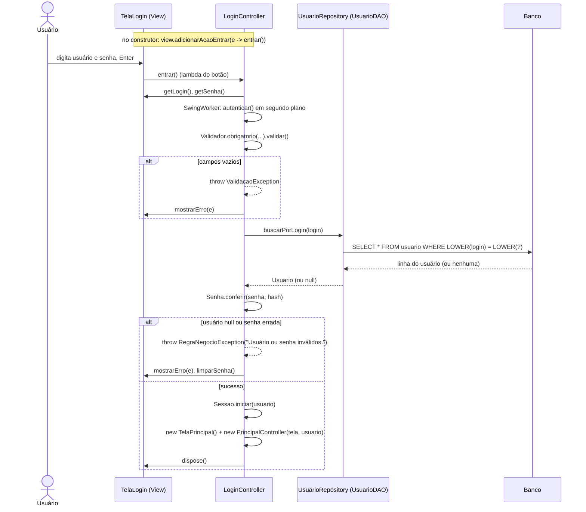

## 2. Exibir calendário

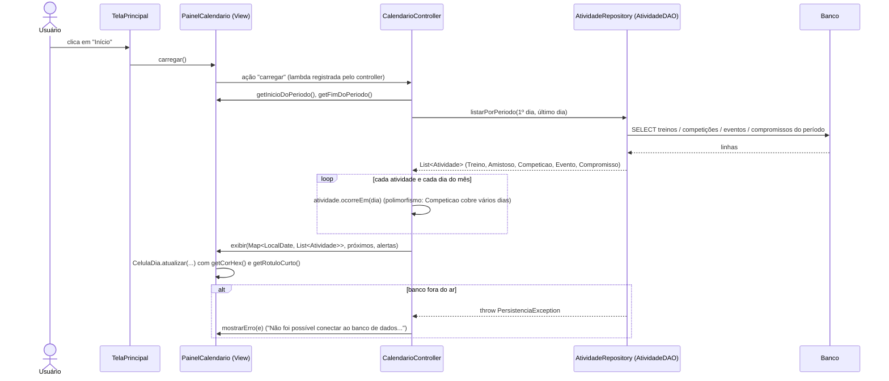

## 3. Incluir compromisso pelo calendário

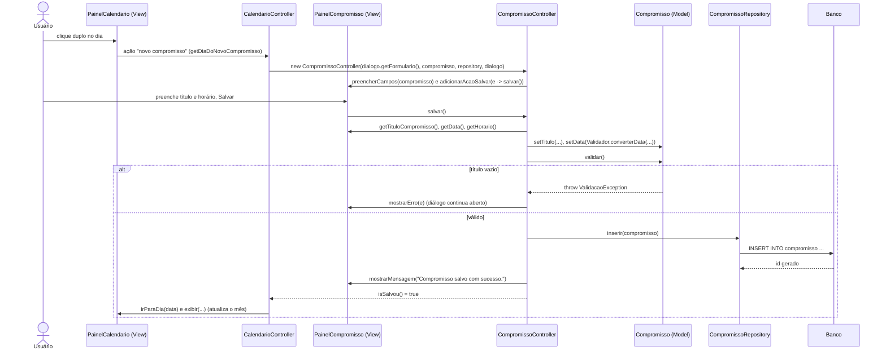

## 4. Cadastrar gestão

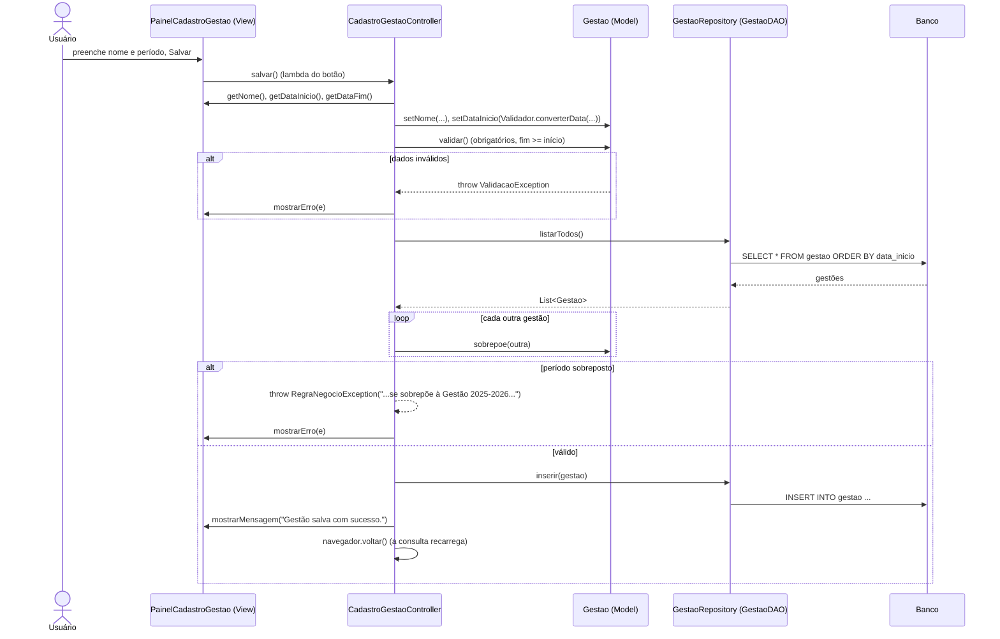

## 5. Adicionar membro a um cargo da gestão

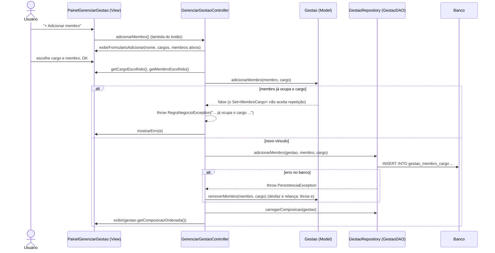

## 6. Incluir atleta

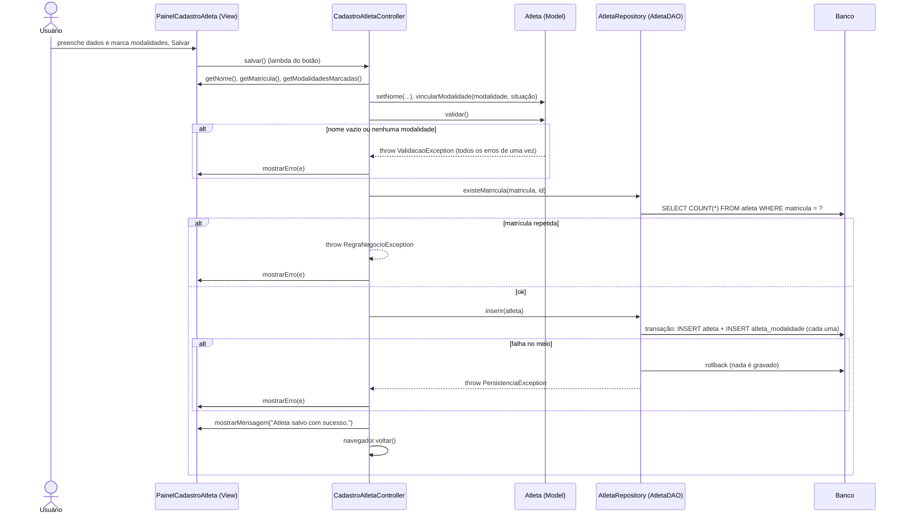

## 7. Excluir atleta com vínculos

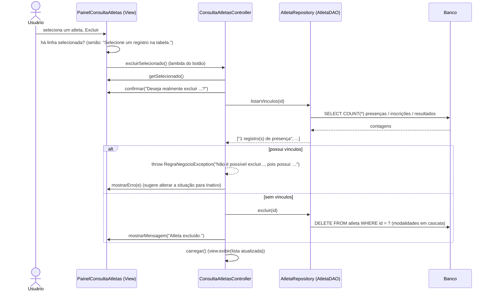

## 8. Gerenciar competição (inscrições)

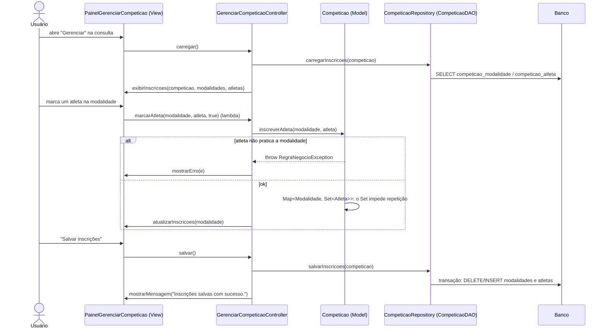

## 9. Lançar resultado

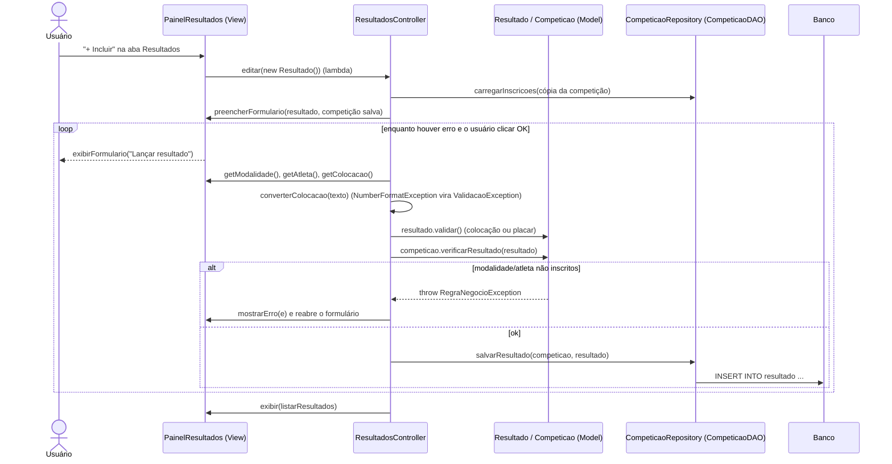

## 10. Cadastrar treino (conflito de horário)

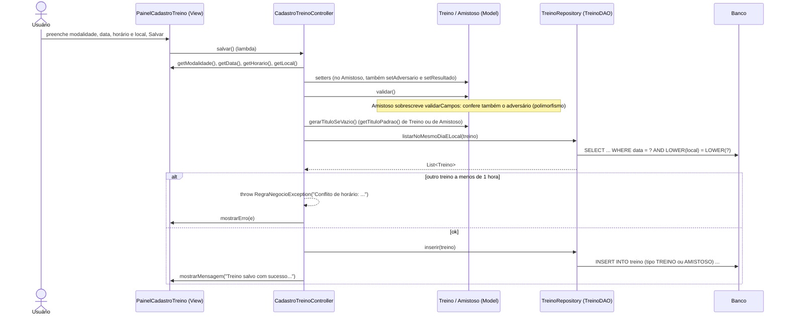

## 11. Registrar presença

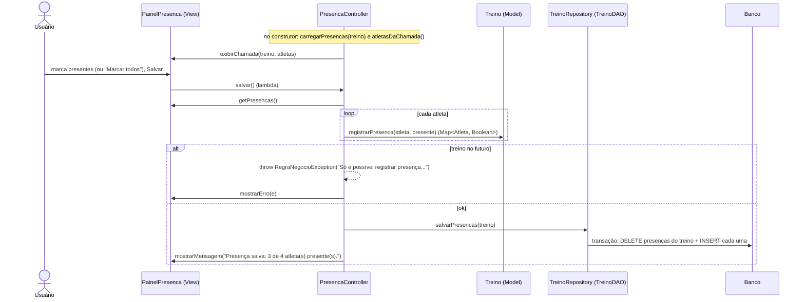

## 12. Concluir tarefa de evento

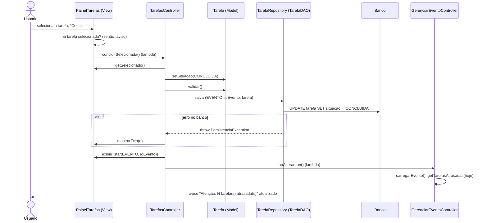

## 13. Adicionar fotos e vídeos aos registros

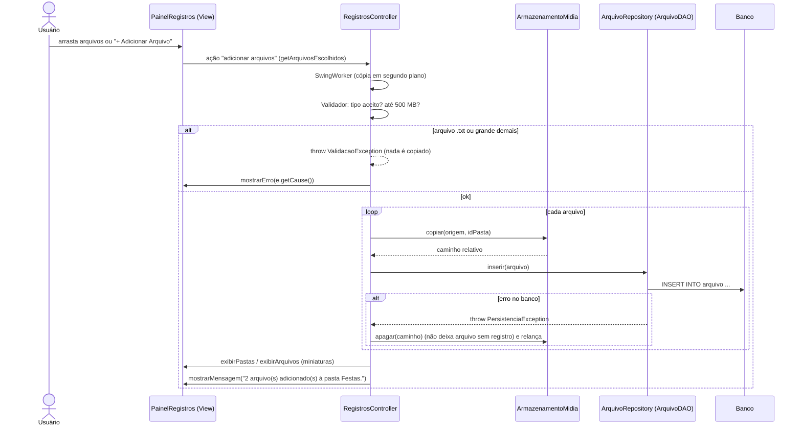
